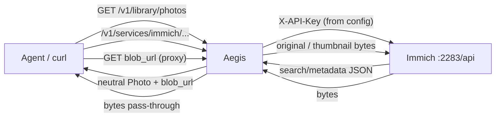

# Live-testing Immich as local canonical photos

This is the operator walkthrough for [issue #39](https://github.com/fudomunro/aegis/issues/39):
prove the Immich connector end to end against a **real Immich instance**, then
record anything the connector still gets wrong.

Use it when you are:

- setting up Immich for the first time and connecting it to Aegis,
- validating a fresh Aegis + Immich setup on your tailnet,
- re-testing after an Immich upgrade or an Aegis connector change,
- or writing up results to close #39.

---

## What is Immich, and why use it?

**Immich** is a self-hosted photo and video library. Think “Google Photos, but the
originals live on hardware you control.” It is open source, actively developed, and
typically runs via Docker Compose on a home server, NAS, or small VM. Phones and
browsers back up to it; you browse and search in its web/mobile apps; a REST API
(default port **2283**) serves metadata and files.

People choose Immich when they want to:

| Goal | What Immich gives you |
|------|------------------------|
| **Own the archive** | Full-resolution originals on your disk, not a cloud quota |
| **Privacy / residency** | Photos need not leave your home network or country |
| **Long-term control** | Exportable storage; you are not subject to a provider sunsetting a product |
| **Offline / tailnet access** | Works on the LAN or over Tailscale without a public endpoint |
| **Phone backup without a cloud plan** | Official mobile apps upload to your server |

**Why wire Immich into Aegis?** Aegis is the agent-facing layer. Once Immich is the
*local canonical* photo home:

- Agents can use the unified library (`GET /v1/library/photos`) and ask about “my photos”
  without an Immich login or API key.
- Aegis stores **metadata only** — the image and video bytes stay on Immich and are
  fetched through a short proxy path when needed.
- Immich can sit beside Google Photos. The same picture merges only on real identity
  (content hash, or capture time + dimensions) — never because filenames match.
- Credentials stay in Aegis (admin setup / `service_connections.json`), not in the
  model’s context.

If you already keep everything in Google Photos and do not want self-hosting, you can
skip Immich entirely and keep Google as `canonical_for: ["photos"]`.

---

## Get an Immich instance (if you do not have one)

You need *some* Immich before Aegis can point at it. The official docs are the source
of truth: **https://docs.immich.app/overview/quick-start/** (Docker Compose is the common path).

### Ready-to-use starter config

Immich’s compose file **requires a file named `.env`**. Their download is
`example.env`; if you forget to rename it (or leave the values blank), Docker
complains:

```text
WARN[0000] The "UPLOAD_LOCATION" variable is not set. Defaulting to a blank string.
invalid spec: :/var/lib/postgresql/data: empty section between colons
```

Use this install instead — **no value editing** for a first single-machine test.
**Write `.env` before the first `docker compose up`** so Postgres initializes
with `DB_DATABASE_NAME=immich`:

```bash
mkdir -p immich-app && cd immich-app
curl -fsSL -o docker-compose.yml \
  https://github.com/immich-app/immich/releases/latest/download/docker-compose.yml
# Save docs/immich-starter.env (or the copy in Admin → Services) as  ./.env
docker compose up -d
# wait until immich_server is healthy (first boot can take a minute)
docker compose ps
# then open http://localhost:2283 and register the first account
```

Starter `.env` (also in [`immich-starter.env`](immich-starter.env)):

```dotenv
# Photos/videos library directory (needs free space)
UPLOAD_LOCATION=./library

# Postgres data directory (metadata only; local disk, not a network share)
DB_DATA_LOCATION=./postgres

# Optional timezone — uncomment if your server is not UTC
# TZ=America/Los_Angeles

# Immich release tag
IMMICH_VERSION=v3

# Local database password (letters/digits only). Not your Immich login.
DB_PASSWORD=postgres

# Postgres user / database (defaults are fine for a new install)
DB_USERNAME=postgres
DB_DATABASE_NAME=immich
```

| Variable | Why it exists | First-install advice |
|----------|---------------|----------------------|
| `UPLOAD_LOCATION` | Where original photos/videos live | `./library` is fine to try; point at a big disk for real use |
| `DB_DATA_LOCATION` | Postgres files (metadata only) | Keep on local disk — not SMB/NFS |
| `TZ` | Timestamps / job schedule | Leave commented if the host is already UTC |
| `IMMICH_VERSION` | Which Immich release to run | Leave `v3` until you deliberately upgrade |
| `DB_PASSWORD` | Immich ↔ its own Postgres | Default works for a private install; letters+digits only if you change it |
| `DB_USERNAME` / `DB_DATABASE_NAME` | Created on first start | Leave defaults — set **before** the first `up` |

### If `http://localhost:2283` is refused after `up -d`

`docker compose up -d` returns as soon as containers are *created*. First boot
pulls images and starts Postgres; the web UI is not ready immediately.
`ERR_CONNECTION_REFUSED` usually means **`immich_server` is not listening yet
(or is crash-looping)**.

```bash
docker compose ps          # want immich_server → healthy, ports 0.0.0.0:2283->2283
docker compose logs --tail=50 immich-server
docker compose logs --tail=20 database
```

| What you see | Cause | Fix |
|--------------|-------|-----|
| `immich_server` *Restarting* / *Created* | Still starting, or failing | Wait for healthy; read server logs |
| Server log: `database "immich" does not exist` | Postgres data dir was initialized **without** `DB_DATABASE_NAME` (first `up` without `.env`) | Throwaway install: `docker exec immich_postgres psql -U postgres -c 'CREATE DATABASE immich;'` then `docker compose restart immich-server`. Clean slate: `docker compose down && rm -rf postgres && docker compose up -d` (library photos are in `UPLOAD_LOCATION`, not `postgres/`) |
| No `2283->2283` in `docker compose ps` | Wrong compose file or port clash | Use the official `docker-compose.yml`; stop whatever else owns 2283 |
| `Up (healthy)` but still refused from another machine | You used `localhost` on a different host | Open `http://<immich-host>:2283` (LAN IP or tailnet name) |
| `variable is not set` / `empty section between colons` | `.env` missing or still `example.env` | Use the starter `.env` above (exact filename `.env`) |

When the UI loads:

1. **Register the first account as admin** (first registration wins).
2. **Get some media in** before expecting Aegis checks to pass — an empty Immich
   is a normal fresh install, not a connector failure. Paths:
   - **Smoke test:** web UI → Upload a handful of JPEGs from this machine.
   - **Phone:** Immich app → sign in to `http://<host>:2283` → backup one album
     (large first backups take hours).
   - **Google Photos library (typical):** [Google Takeout](https://takeout.google.com/)
     → export only **Google Photos** → wait for download links → import with
     [`immich-go`](https://github.com/simulot/immich-go) (Go CLI built for Takeout → Immich).

     **Install `immich-go` first** (Aegis does not bundle it — it is AGPL and a
     standalone app):

     ```bash
     # macOS (Homebrew — easiest)
     brew install immich-go

     # or any OS: grab a release binary and put it on PATH
     # https://github.com/simulot/immich-go/releases
     immich-go --help
     ```

     Then import:

     ```bash
     immich-go upload from-google-photos \
       --server=http://localhost:2283 \
       --api-key=YOUR_IMMICH_API_KEY \
       /path/to/takeout-*.zip
     ```

     Import with the **same** API key you give Aegis — the single-key permission
     set below already includes upload/album/tag for `immich-go`. Keep the Takeout
     zip as a backup; Aegis never stores photo bytes.
3. **Create an API key** for Aegis **and** `immich-go` (one key):
   Immich web UI → **Account** → **API Keys** → create.
   Immich v3 shows a **permissions checkbox list** (not a single “read-only”
   switch). Do **not** use Select all. Tick this union:

   | Permission | Why |
   |------------|-----|
   | `asset.read` | Aegis list (`POST /search/metadata`) |
   | `asset.view` | Aegis thumbnails |
   | `asset.download` | Aegis original bytes via proxy |
   | `album.read` | Aegis album list |
   | `user.read` | Connection test (`GET /users/me`) |
   | `asset.upload` | `immich-go` import |
   | `asset.update` / `asset.copy` / `asset.delete` / `asset.statistics` | `immich-go` Takeout import (dedupe / sidecar / metadata) |
   | `album.create` / `albumAsset.create` | `immich-go` recreates Takeout albums |
   | `stack.create` / `tag.create` / `tag.asset` | `immich-go` stacking + tags |
   | `server.about` | `immich-go` server checks |
   | `job.create` / `job.read` | `immich-go` pauses jobs during import (admin-linked key) |

   Copy the secret immediately — Immich shows it only once. Paste that same
   secret into Aegis and into `immich-go --api-key=…`.
4. **Confirm the API base** from the Aegis host:
   `http://<host>:2283/api` (must end in `/api`). Same machine is
   `http://localhost:2283/api`. On a tailnet, use the tailnet name
   (e.g. `http://photos.home.ts.net:2283/api`) so you do not expose Immich publicly.

### Friendly ts.net name (Tailscale VIP Service, issue #124)

For a stable `https://immich.<tailnet>.ts.net` URL (no `:2283`, real TLS
certs, independent of which machine runs Immich), host Immich as a
**Tailscale VIP Service**. Aegis’s setup guide
(**Admin → Services → Immich → Setup guide → Tailnet URL**) emits the same
walkthrough with copy buttons:

1. **Policy file** — declare a host tag, e.g. `"tagOwners": { "tag:immich-host": ["autogroup:admin"] }`.
2. **Create the service** — Admin API
   `PUT /api/v2/tailnet/{tailnet}/services/svc:immich` with
   `ports: ["tcp:443"]` and that tag. OAuth scopes: `services`, `devices:core`.
3. **Tag the Immich host** — `POST /api/v2/device/{id}/tags`.
   Service hosts must be **tagged** nodes (user-owned nodes cannot host `svc:*`).
4. **Serve on the Immich machine** —
   `tailscale serve --service svc:immich --bg --https=443 http://127.0.0.1:2283`
   then `tailscale serve status` for the exact HTTPS name.
5. **Approve the host** if required —
   `POST .../services/svc:immich/device/{id}/approved`.
6. **Point Aegis** at `https://immich.<tailnet>.ts.net/api` (confirm host from serve status).

Notes:

- This is **Serve**, not Funnel — traffic stays on the tailnet (product rule).
- **Phase 2 (#124):** with a Tailscale Admin API key saved in the Immich
  wizard, Aegis live-checks these steps and can fix `create_service`,
  `tag_host`, `approve`, and the Aegis connect endpoint. `acl_tag` stays
  operator-owned (copyable snippet); `serve` stays on the Immich host.
  Apply is explicit and re-checks first so already-OK steps are skipped.
- Skipping VIP Services is fine for first runs: `http://localhost:2283/api`
  or MagicDNS + `:2283` work immediately.

Optional but useful: install the Immich mobile apps for ongoing camera-roll backup.
Aegis does **not** replace those apps and never ingests photo bytes into its own storage.

---

## Product contract this path must keep (do not “fix” these away)

| Rule | What it means in testing |
|------|--------------------------|
| **Aegis does not store media** | Library responses are metadata only. Bytes are fetched through the proxy and leave with the caller. |
| **Named services first** | Immich is a first-class photo service, not a generic file dump. |
| **Aegis owns credentials** | Agents see `blob_url` on the Aegis proxy, never the Immich API key. |
| **One canonical owner per kind** | At most one non-blocked service may claim `canonical_for: ["photos"]`. |
| **Fail-open** | A broken Immich must not take down the whole photo library or the pre-request hook. |

Related product docs: [README — Immich](../README.md#immich-local--foreign-canonical),
[Adding a data type](adding-data-types.md). Implementation: `immich.go`, `photos.go`.

---

## What you are testing



Two paths matter:

1. **Unified library** — `GET /v1/library/photos` fans out to every `PhotoProvider`
   (Immich, Google Photos, …), merges on real identity, stamps canonical sources.
2. **Service proxy** — `/v1/services/immich/...` attaches the Immich API key and
   forwards, with binary passthrough for downloads.

---

## Prefer the admin UI

**Admin → Services → Immich → Setup guide** (modal) walks install → photos → API key → connect → verify. The compact card on Services still runs this checklist for you: enter the endpoint + API key, **Test connection**, **Save to Aegis**
(writes `service_connections.json`, not `aegis.json`), then **Run checks**.

First-timers get extra hand-holding (issue #121):

- A **next-step** card that names the single thing to do now (install → API key →
  save → verify)
- A four-step **guided ladder** that lights up as you progress
- **Endpoint repair** for common mistakes (missing `http://`, bare `host:port`,
  web UI URL without `/api`)
- Actionable probe codes (`unreachable`, `unauthorized`, `wrong_path`, …) with
  hints (Docker up, Account → API Keys, add `/api`, …)

Use the curl walkthrough below when you need raw evidence for #39 or when
debugging outside the UI.

---

## 0. Prerequisites

- Immich installed and reachable (see **Get an Immich instance** above).
- Aegis built and able to start (`go build -o aegis .`).
- Immich reachable from the Aegis host (same machine, LAN, or tailnet hostname).
  Default Immich API base is `http://<host>:2283/api`.
- An Immich **API key**: Immich UI → Account → API Keys → create with the
  single-key checkbox set below (Aegis + `immich-go` union — Immich v3 is granular).
- Optional but recommended for the mixed-library step: Google Photos already
  connected as another `PhotoProvider`.
- Shell helpers used below:

```bash
export AEGIS=http://localhost:8080
export KEY=dev-key                 # -api-key value (agent)
export ADMIN_KEY=dev-admin-key     # -admin-api-key value (admin surfaces)
export AUTH="Authorization: Bearer $ADMIN_KEY"
# Also accepted: X-Api-Key: $ADMIN_KEY  (or a tailnet admin login in auto/tailnet mode)
```

Aegis auth: agent calls use `Authorization: Bearer <api-key>` / `X-Api-Key`
or tailnet identity (`-auth-mode`, see `SECURITY.md`). Admin surfaces
(`/v1/admin/*`, Immich setup) require `-admin-api-key` or a tailnet user
login (issue #181) — the agent key alone gets **403**.

---

## 1. Configure Immich in Aegis

Add (or adapt) a service block in `aegis.json` / your data-dir config.
Full example: [`aegis.example.json`](../aegis.example.json).

```json
{
  "id": "immich",
  "name": "Immich",
  "aliases": ["immich photos", "self-hosted photos"],
  "action": "inject",
  "endpoint": "http://photos.home.ts.net:2283/api",
  "headers": { "X-API-Key": "YOUR_IMMICH_API_KEY" },
  "cache_ttl": "5m",
  "canonical_for": ["photos"],
  "permissions": { "default": "read", "photos": "read" }
}
```

Checklist before you start:

- [ ] `endpoint` ends with `/api` and is reachable from the Aegis host
      (`curl -H "X-API-Key: $IMMICH_KEY" "$ENDPOINT/server/ping"` or open Immich).
- [ ] `headers["X-API-Key"]` is the Immich key — not the Aegis key.
- [ ] **`canonical_for` is unique.** If `google-photos` already claims
      `canonical_for: ["photos"]`, move that claim to Immich (or omit it on both
      if neither is the home copy). Config load fails if two services claim the
      same kind.
- [ ] `permissions.photos` is `read` (or `write` only if you intend writes —
      this connector is metadata/download oriented).

> **Naming note:** older issues say *Guardian* / `guardian.json`. The product is
> Aegis; config is `aegis.json` (or the OS data directory path).

---

## 2. Start Aegis and smoke-check

```bash
./aegis \
  -addr :8080 \
  -base-url http://localhost:8080 \
  -api-key "$KEY" \
  -token-pass dev-pass \
  -log-level debug \
  -log-format text
```

In another shell:

```bash
# Service is registered and not secret-leaking
curl -sS -H "$AUTH" "$AEGIS/v1/admin/summary" | jq '.services[] | select(.id=="immich")'
```

Expect roughly:

- `id: "immich"`, connected / present,
- `canonical_for: ["photos"]`,
- **no** API key, access token, or `X-API-Key` value in the payload.

Admin UI: open `$AEGIS/v1/admin` and confirm the Immich card shows **canonical
for photos**.

---

## 3. Checklist (issue #39)

Work top to bottom. Each step has a command, what “good” looks like, and what
to file if it fails.

### 3.1 Library listing

```bash
curl -sS -H "$AUTH" "$AEGIS/v1/library/photos" | jq '{
  total, truncated,
  by_service,
  sample: .photos[0]
}'
```

**Pass when:**

- `by_service.immich.status == "ok"` and `count > 0` (for a non-empty library).
- Each Immich photo has `filename`, `taken_at` (when EXIF/file time exists),
  `width`/`height` (when EXIF has dimensions).
- Fail-open still holds: if Google Photos is misconfigured, Immich can still be
  `ok` while that service reports `unauthorized` / `error` — the HTTP call
  itself should still succeed.

**Fail →** check Aegis logs for `immich search/metadata returned …`, verify
endpoint + key, then re-run.

### 3.2 Canonical stamp

```bash
curl -sS -H "$AUTH" "$AEGIS/v1/library/photos" \
  | jq '[.photos[].sources[] | select(.service=="immich")][0]'
```

**Pass when** the Immich source has:

```json
{
  "service": "immich",
  "canonical": true,
  "blob_url": "http://localhost:8080/v1/services/immich/assets/<id>/original",
  "thumbnail_url": "http://localhost:8080/v1/services/immich/assets/<id>/thumbnail"
}
```

`blob_url` / `thumbnail_url` must be **Aegis** proxy URLs, not Immich host URLs
and not bare asset IDs. Deep link `url` may point at the Immich web UI
(`…/photos/<id>`).

If Immich also sets `extra.content_hash` / `extra.checksum`, that is the merge
identity input (good — keep it).

### 3.3 Proxy downloads (bytes stay on Immich)

Pick one asset id from the library response:

```bash
ID=$(curl -sS -H "$AUTH" "$AEGIS/v1/library/photos" \
  | jq -r '[.photos[].sources[] | select(.service=="immich")][0].id')

# Original bytes — should be a real image/video
curl -sS -D - -o /tmp/immich-original.bin \
  -H "$AUTH" "$AEGIS/v1/services/immich/assets/$ID/original" | head -n 20
file /tmp/immich-original.bin

# Thumbnail — should be an image
curl -sS -D - -o /tmp/immich-thumb.jpg \
  -H "$AUTH" "$AEGIS/v1/services/immich/assets/$ID/thumbnail"
file /tmp/immich-thumb.jpg
```

**Pass when:**

- Status is `200`.
- `Content-Type` is a real media type (`image/jpeg`, `image/heic`, `video/mp4`, …),
  not `application/json`.
- `file` reports a decodable image/video, not JSON or empty.
- Aegis logs show a proxy hit — and **no** long-term write of those bytes into
  the Aegis data directory.

Asset search is **not** agent API (issue #119). Immich `POST /search/metadata`
is connector-internal (library listing). Confirm agents cannot reach it as a
provider mirror:

```bash
curl -sS -o /dev/null -w "%{http_code}\n" -H "$AUTH" -H "Content-Type: application/json" \
  -d '{"page":1,"size":5}' \
  "$AEGIS/v1/services/immich/search/metadata"
```

**Pass when:** status is **404**. Use `GET /v1/library/photos` for listing.

### 3.4 Admin map / flow

```bash
curl -sS -H "$AUTH" "$AEGIS/v1/admin/flow" | jq '
  .nodes[]? | select((.id // .service // "") | test("immich"; "i"))'
```

Or open **Admin → Map** in the browser.

**Pass when:**

- Immich appears as a connected service (with the photos kind).
- Canonical-for-photos is visible on the service card / summary.
- A node note along the lines of **“Photo bytes stay on this service (canonical)”**
  is present — that is the product rule the map is supposed to teach.

### 3.5 Auth failure is loud and safe

Temporarily break the key (wrong value, or remove `headers`), restart or clear
cache if needed, then:

```bash
curl -sS -H "$AUTH" "$AEGIS/v1/library/photos" | jq '.by_service.immich'
curl -sS -o /dev/null -w "%{http_code}\n" -H "$AUTH" \
  "$AEGIS/v1/services/immich/assets/$ID/original"
```

**Pass when:**

- Library: `by_service.immich.status` is `unauthorized` or `error` with a short
  reason (e.g. hint to set `X-API-Key`). Other photo services still report.
- Proxy download: **401/403** with a clear JSON error mentioning the Immich API
  key — not a 200 HTML login page and not a silent empty body.
- The pre-request hook still returns `allow` (fail-open).

Restore the good key afterwards.

### 3.6 Large library (pagination + `truncated`)

Immich listing uses `POST /search/metadata` with `size: 250` and follows
`assets.nextPage` until it ends or hits Aegis’s page cap
(`libraryPageCap = 200` pages → at most **50 000** assets per service per call).

```bash
curl -sS -H "$AUTH" "$AEGIS/v1/library/photos" | jq '{
  total,
  truncated,
  immich: .by_service.immich
}'
```

**Pass when:**

- A multi-thousand-asset Immich returns more than 250 photos in one library call
  (you are not stuck on page 1).
- `by_service.immich.truncated` / top-level `truncated` are `true` only when the
  page cap was actually hit with more upstream items.
- `nextPage` quirks (string, number, or null) do not crash the connector — check
  logs for decode errors.

**Note:** Google Photos is picker-based and only lists the last pick; do not
compare its `count` to Immich’s full library.

### 3.7 Mixed library merge (identity, not filename)

With Immich **and** Google Photos (or two Immich-sourced fixtures) visible:

```bash
curl -sS -H "$AUTH" "$AEGIS/v1/library/photos" | jq '
  [.photos[] | select((.sources|length) > 1) | {
    filename, taken_at, width, height,
    services: [.sources[].service],
    hashes: [.sources[].extra.content_hash?]
  }][0:5]'
```

**Pass when:**

- Multi-source photos merge only when identity matches:
  - `content_hash` (Immich checksum / provider hash), or
  - `taken_at` + `width`/`height`.
- Same filename alone (e.g. two `IMG_0001.jpg` from different days) stays
  **two** photos.
- `synced: true` on the aggregate when any merge happened.
- Filename-only near-duplicates do not collapse.

This is the product rule in `photoContentKey` (`photos.go`): filename is never
a merge key.

---

## 4. Recording results

Copy this into the #39 comment (or your test log):

```markdown
### Environment
- Aegis commit:
- Immich version:
- endpoint:
- auth: admin key / tailnet admin login (issue #181)
- other photo providers:

### Checklist
- [ ] library listing
- [ ] canonical stamp + proxy blob_url
- [ ] original / thumbnail bytes
- [ ] admin map + “bytes stay on Immich” note
- [ ] bad API key → clear unauthorized
- [ ] large library pagination / truncated
- [ ] mixed-library merge identity

### Quirks found
- Immich `search/metadata` shape / `nextPage` type:
- MIME / EXIF gaps:
- anything else:

### Follow-ups
```

Anything that fails the product rules is a bug against the connector
(`fix/…` PR referencing #39), not a reason to store photo bytes in Aegis or to
ask agents for Immich keys.

---

## 5. Troubleshooting

| Symptom | Likely cause | What to do |
|---------|--------------|------------|
| `by_service.immich` missing | Service id not `immich`, blocked, or no `PhotoProvider` | Confirm `id` is exactly `immich`; service `action` is not `block`; process restarted after config change |
| Config load error mentioning `canonical_for` | Two services claim `photos` | Keep the claim on exactly one home (Immich **or** Google Photos) |
| 401/403 on proxy | Missing/wrong `X-API-Key` | Set `headers["X-API-Key"]` to the Immich API key (Account → API Keys) |
| 502 “Immich request failed” | Endpoint unreachable from Aegis | Fix hostname/port; Immich is usually `…:2283/api` on the tailnet |
| Library empty but Immich UI full | Wrong endpoint (missing `/api`), empty library user, or permissions | Verify `endpoint` ends with `/api`; check Immich account/library |
| Library empty and Immich UI empty | Fresh install — nothing to list yet | Upload a few photos, phone-backup, or Google Takeout + `immich-go` (see “Get photos into Immich”). Then re-run checks |
| JSON in `original` download | Path not treated as binary or Immich error body | Expect 200 + media type; 401/403 should be JSON errors from Aegis |
| Photos never merge across services | No shared hash / taken_at+dimensions | Expected when metadata is incomplete; filename will not merge (by design) |
| `truncated: true` on a small library | Page loop bug or Immich sending a looping `nextPage` | Note Immich version + `nextPage` sample in #39; connector treats `null`/`""`/non-positive as end |
| Key leaked in Admin/API | Regression | Treat as security bug — presence flags only, never header values |

---

## 6. After a green run

1. Post the checklist + environment + quirks on
   [#39](https://github.com/fudomunro/aegis/issues/39).
2. Open focused `fix/…` PRs for connector bugs (one concern per PR).
3. Leave face/person groups (`Photo.people`) to later work — not part of #39.
4. Other local stores (PhotoPrism, …) stay under
   [#21](https://github.com/fudomunro/aegis/issues/21) until this path is proven.

### Definition of done for #39

- [ ] All checklist items above pass on a real Immich (record version).
- [ ] No secrets in logs, admin payloads, or the write-up.
- [ ] Quirks and residual bugs filed (issue comments or linked PRs).
- [ ] Aegis still never persists photo bytes; `canonical_for: ["photos"]` has a
      single owner in the tested config.
