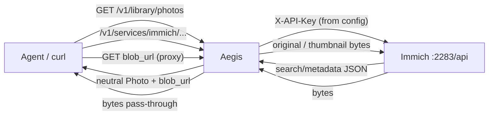

# Live-testing Immich as local canonical photos

This is the operator walkthrough for [issue #39](https://github.com/fudomunro/aegis/issues/39):
prove the Immich connector end to end against a **real Immich instance**, then
record anything the connector still gets wrong.

Use it when you are:

- setting up Immich for the first time and connecting it to Aegis,
- validating a fresh Aegis + Immich setup on your tailnet,
- re-testing after an Immich upgrade or an Aegis connector change,
- or writing up results to close #39.

---

## What is Immich, and why use it?

**Immich** is a self-hosted photo and video library. Think “Google Photos, but the
originals live on hardware you control.” It is open source, actively developed, and
typically runs via Docker Compose on a home server, NAS, or small VM. Phones and
browsers back up to it; you browse and search in its web/mobile apps; a REST API
(default port **2283**) serves metadata and files.

People choose Immich when they want to:

| Goal | What Immich gives you |
|------|------------------------|
| **Own the archive** | Full-resolution originals on your disk, not a cloud quota |
| **Privacy / residency** | Photos need not leave your home network or country |
| **Long-term control** | Exportable storage; you are not subject to a provider sunsetting a product |
| **Offline / tailnet access** | Works on the LAN or over Tailscale without a public endpoint |
| **Phone backup without a cloud plan** | Official mobile apps upload to your server |

**Why wire Immich into Aegis?** Aegis is the agent-facing layer. Once Immich is the
*local canonical* photo home:

- Agents can use the unified library (`GET /v1/library/photos`) and ask about “my photos”
  without an Immich login or API key.
- Aegis stores **metadata only** — the image and video bytes stay on Immich and are
  fetched through a short proxy path when needed.
- Immich can sit beside Google Photos. The same picture merges only on real identity
  (content hash, or capture time + dimensions) — never because filenames match.
- Credentials stay in Aegis (admin setup / `service_connections.json`), not in the
  model’s context.

If you already keep everything in Google Photos and do not want self-hosting, you can
skip Immich entirely and keep Google as `canonical_for: ["photos"]`.

---

## Get an Immich instance (if you do not have one)

You need *some* Immich before Aegis can point at it. The official docs are the source
of truth: **https://immich.app/docs/install/overview** (Docker Compose is the common path).

Minimum useful setup:

1. **Install** Immich on a machine that will stay on when you want photos (home server,
   NAS, VM). Note the host and port — web UI and API share **2283** by default.
2. **Open the web UI** (`http://<host>:2283`), create the first admin account.
3. **Get some media in**: phone app backup, web upload, or a mounted library. A few
   dozen photos are enough for a smoke test.
4. **Create an API key** for Aegis:
   Immich web UI → **Account** → **API Keys** → create.
   **Read-only is enough** for listing and downloads. Copy the key immediately —
   Immich shows it only once.
5. **Confirm the API base** from the Aegis host:
   `http://<host>:2283/api` (must end in `/api`). On a tailnet, use the tailnet name
   (e.g. `http://photos.home.ts.net:2283/api`) so you do not expose Immich publicly.

Optional but useful: install the Immich mobile apps for ongoing camera-roll backup.
Aegis does **not** replace those apps and never ingests photo bytes into its own storage.

---

## Product contract this path must keep (do not “fix” these away)

| Rule | What it means in testing |
|------|--------------------------|
| **Aegis does not store media** | Library responses are metadata only. Bytes are fetched through the proxy and leave with the caller. |
| **Named services first** | Immich is a first-class photo service, not a generic file dump. |
| **Aegis owns credentials** | Agents see `blob_url` on the Aegis proxy, never the Immich API key. |
| **One canonical owner per kind** | At most one non-blocked service may claim `canonical_for: ["photos"]`. |
| **Fail-open** | A broken Immich must not take down the whole photo library or the pre-request hook. |

Related product docs: [README — Immich](../README.md#immich-local--foreign-canonical),
[Adding a data type](adding-data-types.md). Implementation: `immich.go`, `photos.go`.

---

## What you are testing



Two paths matter:

1. **Unified library** — `GET /v1/library/photos` fans out to every `PhotoProvider`
   (Immich, Google Photos, …), merges on real identity, stamps canonical sources.
2. **Service proxy** — `/v1/services/immich/...` attaches the Immich API key and
   forwards, with binary passthrough for downloads.

---

## Prefer the admin UI

**Admin → Services → Immich — local canonical photos** runs this checklist for
you: enter the endpoint + API key, **Test connection**, **Save to Aegis**
(writes `service_connections.json`, not `aegis.json`), then **Run checks**.
Use the curl walkthrough below when you need raw evidence for #39 or when
debugging outside the UI.

---

## 0. Prerequisites

- Immich installed and reachable (see **Get an Immich instance** above).
- Aegis built and able to start (`go build -o aegis .`).
- Immich reachable from the Aegis host (same machine, LAN, or tailnet hostname).
  Default Immich API base is `http://<host>:2283/api`.
- An Immich **API key**: Immich UI → Account → API Keys → create (read is enough
  for listing and download tests).
- Optional but recommended for the mixed-library step: Google Photos already
  connected as another `PhotoProvider`.
- Shell helpers used below:

```bash
export AEGIS=http://localhost:8080
export KEY=dev-key                 # -api-key value
export AUTH="Authorization: Bearer $KEY"
# Also accepted: X-Api-Key: $KEY  (or a tailnet identity in auto/tailnet mode)
```

Aegis auth: `Authorization: Bearer <api-key>` or `X-Api-Key`, depending on
`-auth-mode` (see `SECURITY.md`). Tailnet identity works in `auto`/`tailnet`.

---

## 1. Configure Immich in Aegis

Add (or adapt) a service block in `aegis.json` / your data-dir config.
Full example: [`aegis.example.json`](../aegis.example.json).

```json
{
  "id": "immich",
  "name": "Immich",
  "aliases": ["immich photos", "self-hosted photos"],
  "action": "inject",
  "endpoint": "http://photos.home.ts.net:2283/api",
  "headers": { "X-API-Key": "YOUR_IMMICH_API_KEY" },
  "cache_ttl": "5m",
  "canonical_for": ["photos"],
  "permissions": { "default": "read", "photos": "read" }
}
```

Checklist before you start:

- [ ] `endpoint` ends with `/api` and is reachable from the Aegis host
      (`curl -H "X-API-Key: $IMMICH_KEY" "$ENDPOINT/server/ping"` or open Immich).
- [ ] `headers["X-API-Key"]` is the Immich key — not the Aegis key.
- [ ] **`canonical_for` is unique.** If `google-photos` already claims
      `canonical_for: ["photos"]`, move that claim to Immich (or omit it on both
      if neither is the home copy). Config load fails if two services claim the
      same kind.
- [ ] `permissions.photos` is `read` (or `write` only if you intend writes —
      this connector is metadata/download oriented).

> **Naming note:** older issues say *Guardian* / `guardian.json`. The product is
> Aegis; config is `aegis.json` (or the OS data directory path).

---

## 2. Start Aegis and smoke-check

```bash
./aegis \
  -addr :8080 \
  -base-url http://localhost:8080 \
  -api-key "$KEY" \
  -token-pass dev-pass \
  -log-level debug \
  -log-format text
```

In another shell:

```bash
# Service is registered and not secret-leaking
curl -sS -H "$AUTH" "$AEGIS/v1/admin/summary" | jq '.services[] | select(.id=="immich")'
```

Expect roughly:

- `id: "immich"`, connected / present,
- `canonical_for: ["photos"]`,
- **no** API key, access token, or `X-API-Key` value in the payload.

Admin UI: open `$AEGIS/v1/admin` and confirm the Immich card shows **canonical
for photos**.

---

## 3. Checklist (issue #39)

Work top to bottom. Each step has a command, what “good” looks like, and what
to file if it fails.

### 3.1 Library listing

```bash
curl -sS -H "$AUTH" "$AEGIS/v1/library/photos" | jq '{
  total, truncated,
  by_service,
  sample: .photos[0]
}'
```

**Pass when:**

- `by_service.immich.status == "ok"` and `count > 0` (for a non-empty library).
- Each Immich photo has `filename`, `taken_at` (when EXIF/file time exists),
  `width`/`height` (when EXIF has dimensions).
- Fail-open still holds: if Google Photos is misconfigured, Immich can still be
  `ok` while that service reports `unauthorized` / `error` — the HTTP call
  itself should still succeed.

**Fail →** check Aegis logs for `immich search/metadata returned …`, verify
endpoint + key, then re-run.

### 3.2 Canonical stamp

```bash
curl -sS -H "$AUTH" "$AEGIS/v1/library/photos" \
  | jq '[.photos[].sources[] | select(.service=="immich")][0]'
```

**Pass when** the Immich source has:

```json
{
  "service": "immich",
  "canonical": true,
  "blob_url": "http://localhost:8080/v1/services/immich/assets/<id>/original",
  "thumbnail_url": "http://localhost:8080/v1/services/immich/assets/<id>/thumbnail"
}
```

`blob_url` / `thumbnail_url` must be **Aegis** proxy URLs, not Immich host URLs
and not bare asset IDs. Deep link `url` may point at the Immich web UI
(`…/photos/<id>`).

If Immich also sets `extra.content_hash` / `extra.checksum`, that is the merge
identity input (good — keep it).

### 3.3 Proxy downloads (bytes stay on Immich)

Pick one asset id from the library response:

```bash
ID=$(curl -sS -H "$AUTH" "$AEGIS/v1/library/photos" \
  | jq -r '[.photos[].sources[] | select(.service=="immich")][0].id')

# Original bytes — should be a real image/video
curl -sS -D - -o /tmp/immich-original.bin \
  -H "$AUTH" "$AEGIS/v1/services/immich/assets/$ID/original" | head -n 20
file /tmp/immich-original.bin

# Thumbnail — should be an image
curl -sS -D - -o /tmp/immich-thumb.jpg \
  -H "$AUTH" "$AEGIS/v1/services/immich/assets/$ID/thumbnail"
file /tmp/immich-thumb.jpg
```

**Pass when:**

- Status is `200`.
- `Content-Type` is a real media type (`image/jpeg`, `image/heic`, `video/mp4`, …),
  not `application/json`.
- `file` reports a decodable image/video, not JSON or empty.
- Aegis logs show a proxy hit — and **no** long-term write of those bytes into
  the Aegis data directory.

Also sanity-check raw Immich JSON passthrough (agent-facing Immich shape):

```bash
curl -sS -H "$AUTH" -H "Content-Type: application/json" \
  -d '{"page":1,"size":5,"withExif":true}' \
  "$AEGIS/v1/services/immich/search/metadata" | jq '.assets | {total, count, items: (.items|length)}'
```

### 3.4 Admin map / flow

```bash
curl -sS -H "$AUTH" "$AEGIS/v1/admin/flow" | jq '
  .nodes[]? | select((.id // .service // "") | test("immich"; "i"))'
```

Or open **Admin → Map** in the browser.

**Pass when:**

- Immich appears as a connected service (with the photos kind).
- Canonical-for-photos is visible on the service card / summary.
- A node note along the lines of **“Photo bytes stay on this service (canonical)”**
  is present — that is the product rule the map is supposed to teach.

### 3.5 Auth failure is loud and safe

Temporarily break the key (wrong value, or remove `headers`), restart or clear
cache if needed, then:

```bash
curl -sS -H "$AUTH" "$AEGIS/v1/library/photos" | jq '.by_service.immich'
curl -sS -o /dev/null -w "%{http_code}\n" -H "$AUTH" \
  "$AEGIS/v1/services/immich/assets/$ID/original"
```

**Pass when:**

- Library: `by_service.immich.status` is `unauthorized` or `error` with a short
  reason (e.g. hint to set `X-API-Key`). Other photo services still report.
- Proxy download: **401/403** with a clear JSON error mentioning the Immich API
  key — not a 200 HTML login page and not a silent empty body.
- The pre-request hook still returns `allow` (fail-open).

Restore the good key afterwards.

### 3.6 Large library (pagination + `truncated`)

Immich listing uses `POST /search/metadata` with `size: 250` and follows
`assets.nextPage` until it ends or hits Aegis’s page cap
(`libraryPageCap = 200` pages → at most **50 000** assets per service per call).

```bash
curl -sS -H "$AUTH" "$AEGIS/v1/library/photos" | jq '{
  total,
  truncated,
  immich: .by_service.immich
}'
```

**Pass when:**

- A multi-thousand-asset Immich returns more than 250 photos in one library call
  (you are not stuck on page 1).
- `by_service.immich.truncated` / top-level `truncated` are `true` only when the
  page cap was actually hit with more upstream items.
- `nextPage` quirks (string, number, or null) do not crash the connector — check
  logs for decode errors.

**Note:** Google Photos is picker-based and only lists the last pick; do not
compare its `count` to Immich’s full library.

### 3.7 Mixed library merge (identity, not filename)

With Immich **and** Google Photos (or two Immich-sourced fixtures) visible:

```bash
curl -sS -H "$AUTH" "$AEGIS/v1/library/photos" | jq '
  [.photos[] | select((.sources|length) > 1) | {
    filename, taken_at, width, height,
    services: [.sources[].service],
    hashes: [.sources[].extra.content_hash?]
  }][0:5]'
```

**Pass when:**

- Multi-source photos merge only when identity matches:
  - `content_hash` (Immich checksum / provider hash), or
  - `taken_at` + `width`/`height`.
- Same filename alone (e.g. two `IMG_0001.jpg` from different days) stays
  **two** photos.
- `synced: true` on the aggregate when any merge happened.
- Filename-only near-duplicates do not collapse.

This is the product rule in `photoContentKey` (`photos.go`): filename is never
a merge key.

---

## 4. Recording results

Copy this into the #39 comment (or your test log):

```markdown
### Environment
- Aegis commit:
- Immich version:
- endpoint:
- auth: API key / tailnet
- other photo providers:

### Checklist
- [ ] library listing
- [ ] canonical stamp + proxy blob_url
- [ ] original / thumbnail bytes
- [ ] admin map + “bytes stay on Immich” note
- [ ] bad API key → clear unauthorized
- [ ] large library pagination / truncated
- [ ] mixed-library merge identity

### Quirks found
- Immich `search/metadata` shape / `nextPage` type:
- MIME / EXIF gaps:
- anything else:

### Follow-ups
```

Anything that fails the product rules is a bug against the connector
(`fix/…` PR referencing #39), not a reason to store photo bytes in Aegis or to
ask agents for Immich keys.

---

## 5. Troubleshooting

| Symptom | Likely cause | What to do |
|---------|--------------|------------|
| `by_service.immich` missing | Service id not `immich`, blocked, or no `PhotoProvider` | Confirm `id` is exactly `immich`; service `action` is not `block`; process restarted after config change |
| Config load error mentioning `canonical_for` | Two services claim `photos` | Keep the claim on exactly one home (Immich **or** Google Photos) |
| 401/403 on proxy | Missing/wrong `X-API-Key` | Set `headers["X-API-Key"]` to the Immich API key (Account → API Keys) |
| 502 “Immich request failed” | Endpoint unreachable from Aegis | Fix hostname/port; Immich is usually `…:2283/api` on the tailnet |
| Library empty but Immich UI full | Wrong endpoint (missing `/api`), empty library user, or permissions | Verify `endpoint` ends with `/api`; check Immich account/library |
| JSON in `original` download | Path not treated as binary or Immich error body | Expect 200 + media type; 401/403 should be JSON errors from Aegis |
| Photos never merge across services | No shared hash / taken_at+dimensions | Expected when metadata is incomplete; filename will not merge (by design) |
| `truncated: true` on a small library | Page loop bug or Immich sending a looping `nextPage` | Note Immich version + `nextPage` sample in #39; connector treats `null`/`""`/non-positive as end |
| Key leaked in Admin/API | Regression | Treat as security bug — presence flags only, never header values |

---

## 6. After a green run

1. Post the checklist + environment + quirks on
   [#39](https://github.com/fudomunro/aegis/issues/39).
2. Open focused `fix/…` PRs for connector bugs (one concern per PR).
3. Leave face/person groups (`Photo.people`) to later work — not part of #39.
4. Other local stores (PhotoPrism, …) stay under
   [#21](https://github.com/fudomunro/aegis/issues/21) until this path is proven.

### Definition of done for #39

- [ ] All checklist items above pass on a real Immich (record version).
- [ ] No secrets in logs, admin payloads, or the write-up.
- [ ] Quirks and residual bugs filed (issue comments or linked PRs).
- [ ] Aegis still never persists photo bytes; `canonical_for: ["photos"]` has a
      single owner in the tested config.
